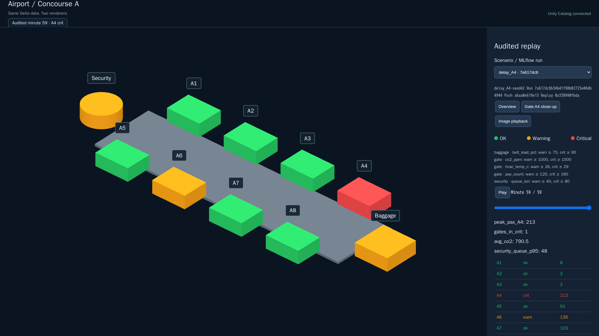
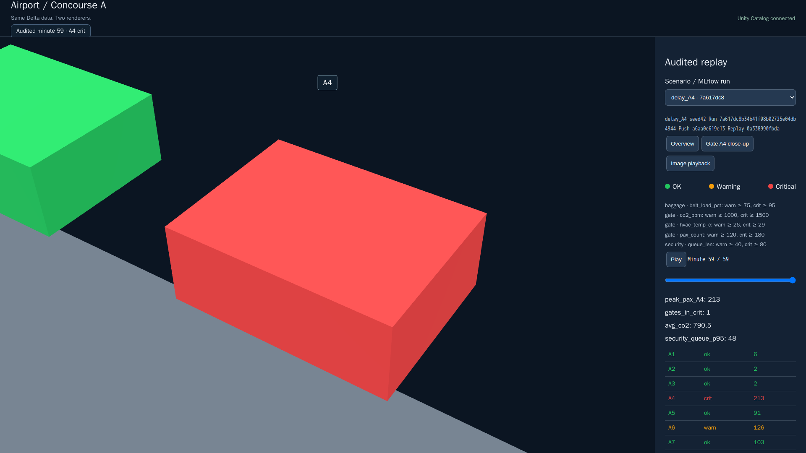
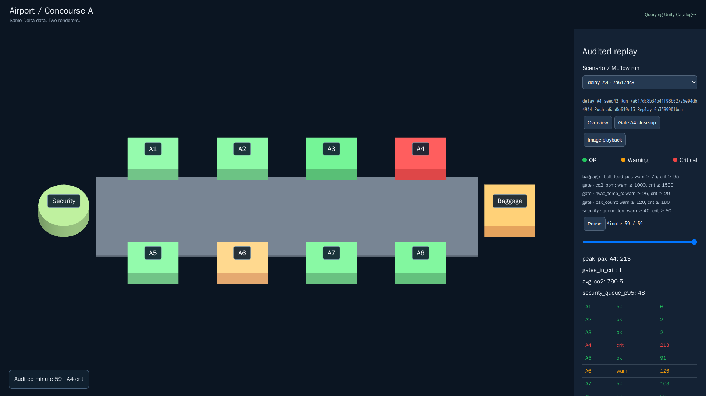

# Browser twin (three.js)

Audited replay of Concourse A in the browser. Same governed Delta data as the
Omniverse path — two renderers.

## M7 polish

*3/4 overview — lifted gate labels, status badge under the title.*

*Gate A4 close-up — crit at minute 59 of the delay_A4 replay.*

*Delay / ripple filming beat — A4 critical with the ripple transition in view.*
